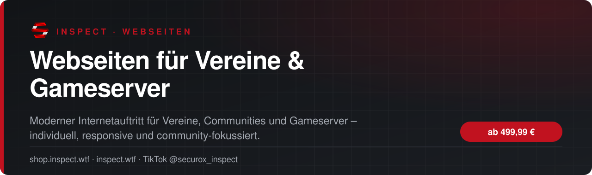
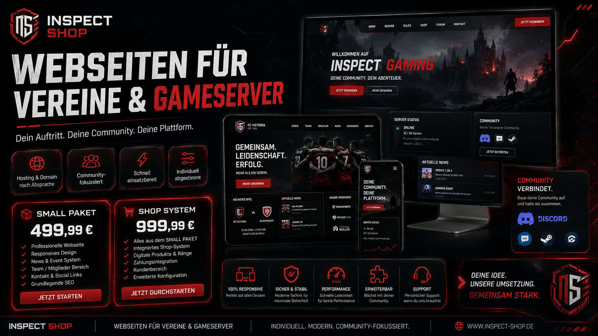

<!-- inspect-showcase: automatisch erzeugt, Änderungen bitte im Shop vornehmen -->

  
  
  

  
  
  

 

 

## Das Wichtigste auf einen Blick

<table>
  <tr>
    <td width="50%" valign="top">✔&nbsp; <b>Individueller Internetauftritt für Vereine, Communities und Gameserver</b></td>
    <td width="50%" valign="top">✔&nbsp; <b>Startseite, Über-uns, Team, Regeln, News, Events oder Kontakt nach Wunsch</b></td>
  </tr>
  <tr>
    <td width="50%" valign="top">✔&nbsp; <b>Discord-, Steam-, Social- und Serverlinks möglich</b></td>
    <td width="50%" valign="top">✔&nbsp; <b>Responsive Design für alle Geräte</b></td>
  </tr>
</table>

## Überblick

Individuelle Webseiten für Vereine, Gaming-Communities und Gameserver. Ob Vereinsseite, Serverauftritt, Regelwerk, News, Teamseite, Eventbereich, Discord-Verknüpfung oder optionales Shop-System: wir bauen eine moderne Internetpräsenz, die deine Community sichtbar macht und professionell präsentiert. Hosting und Domain werden nach Absprache separat geregelt.

## Alle weiteren Funktionen

- Grundlegende SEO- und Performance-Optimierung
- Optionales Shop-System für digitale Inhalte, Mitgliedschaft, Produkte oder Serverpakete
- Hosting und Domain nach Absprache und separater Vereinbarung
- Zusätzliche Funktionen und Erweiterungen werden separat besprochen und vertraglich geregelt

## Preis

| Paket | Leistungsumfang | Preis |
|:--|:--|--:|
| **Small Paket** | Professioneller Vereins- oder Gameserver-Auftritt mit moderner Startseite, Basisstruktur, Kontakt und Community-Fokus. | **499,99 €** |
| **Shop-System** | Erweiterte Umsetzung mit integriertem Shop-System für Community-Produkte, digitale Inhalte oder Serverangebote. Zusatzkosten für Hosting und Domain nach Vereinbarung. | **999,99 €** |

Sichere Zahlung mit PayPal oder Kreditkarte · Rechnung als PDF · Support auf Deutsch

## So läuft die Beauftragung ab

1. **Im Shop buchen** – sicher bezahlen mit PayPal oder Kreditkarte.
2. **Persönliche Abstimmung** – wir klären Umfang, Wünsche und Ablauf direkt mit dir.
3. **Umsetzung & Übergabe** – mit festem Ansprechpartner über Discord.

## Warum INSPECT?

<table>
  <tr>
    <td width="50%" valign="top"><b>🇩🇪 Entwickelt in Deutschland</b> Konzeption, Entwicklung und Support aus einer Hand.</td>
    <td width="50%" valign="top"><b>💬 Persönlicher Support</b> Schnelle Hilfe auf Deutsch im INSPECT Discord.</td>
  </tr>
  <tr>
    <td width="50%" valign="top"><b>🔒 Sichere Zahlung</b> PayPal oder Kreditkarte, Rechnung automatisch als PDF.</td>
    <td width="50%" valign="top"><b>🤝 Individuelle Abstimmung</b> Leistungsumfang wird vor Beginn gemeinsam festgelegt.</td>
  </tr>
</table>

## Häufige Fragen

<b>Wie läuft die Beauftragung ab?</b>

 

Nach der Buchung im Shop melden wir uns bei dir und stimmen Umfang, Inhalte und Zeitplan gemeinsam ab.

<b>Kann ich vorher Fragen stellen?</b>

 

Ja – schreib uns einfach im [INSPECT Discord](https://discord.gg/inspect) oder per E-Mail an [info@inspect.wtf](mailto:info@inspect.wtf).

<b>Wo kaufe ich offiziell?</b>

 

Ausschließlich im INSPECT Shop unter [shop.inspect.wtf](https://shop.inspect.wtf). Angebote von Dritten stammen nicht von uns.

## Kontakt

| | |
|:--|:--|
| 🛒 Shop | [shop.inspect.wtf](https://shop.inspect.wtf) |
| 🌐 Website | [inspect.wtf](https://inspect.wtf) |
| 💬 Discord | [discord.gg/inspect](https://discord.gg/inspect) |
| 🎬 TikTok | [@securox_inspect](https://www.tiktok.com/@securox_inspect) |
| ✉️ E-Mail | [info@inspect.wtf](mailto:info@inspect.wtf) |

---

<b>SecuroX Inspect</b> · Offizielle Produktpräsentation · Dieses Repository enthält keinen Quellcode und keine Produktdateien. 
Kauf und Lizenzen ausschließlich über <a href="https://shop.inspect.wtf">shop.inspect.wtf</a> · Inhalte werden automatisch aus dem Shop aktualisiert.

